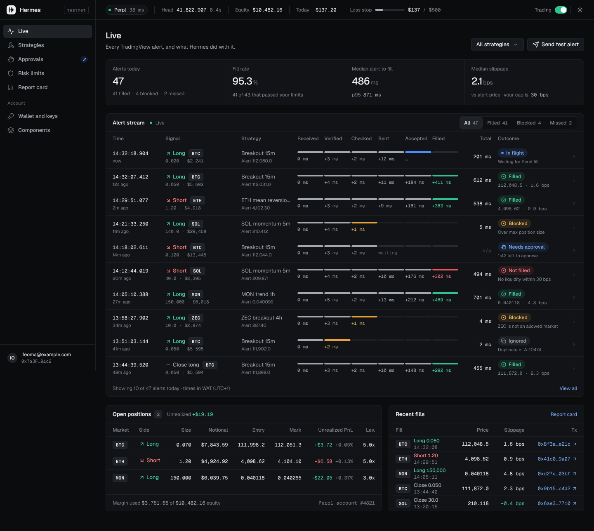
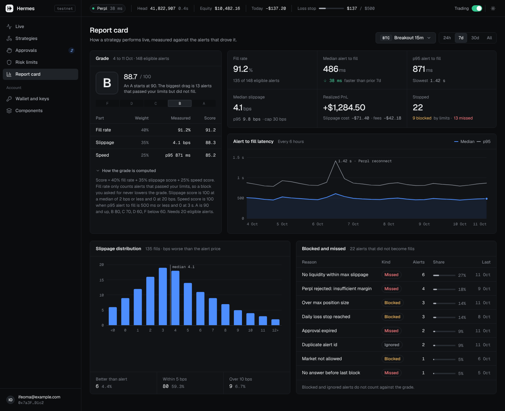
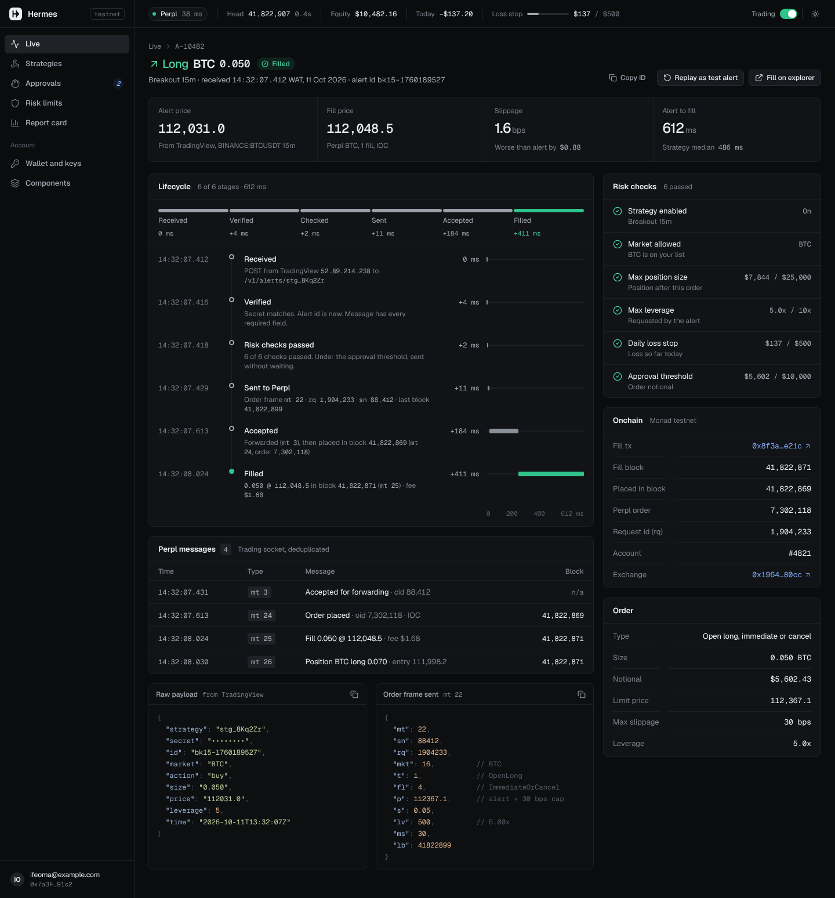
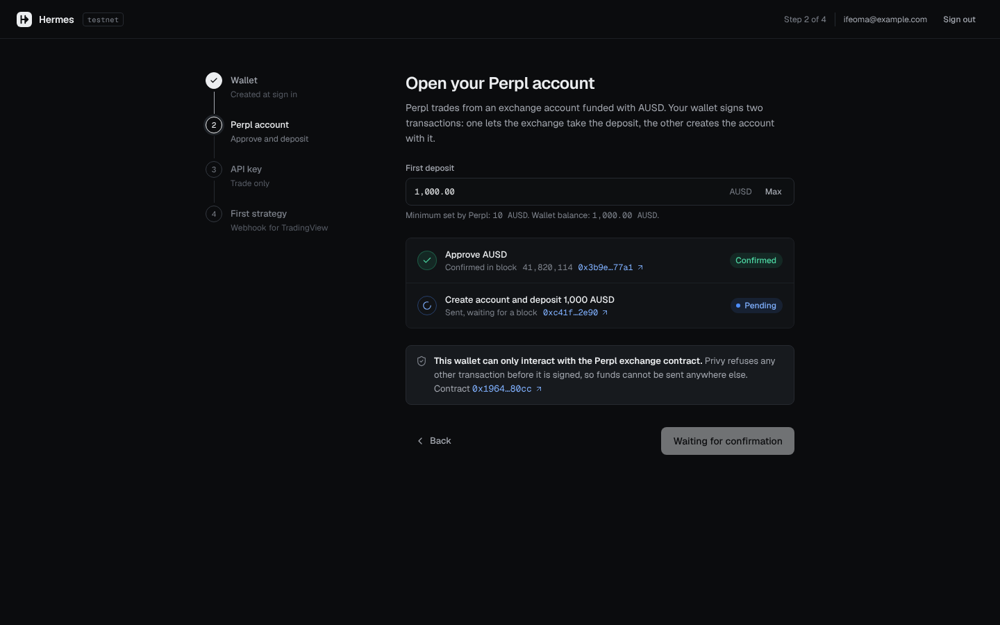
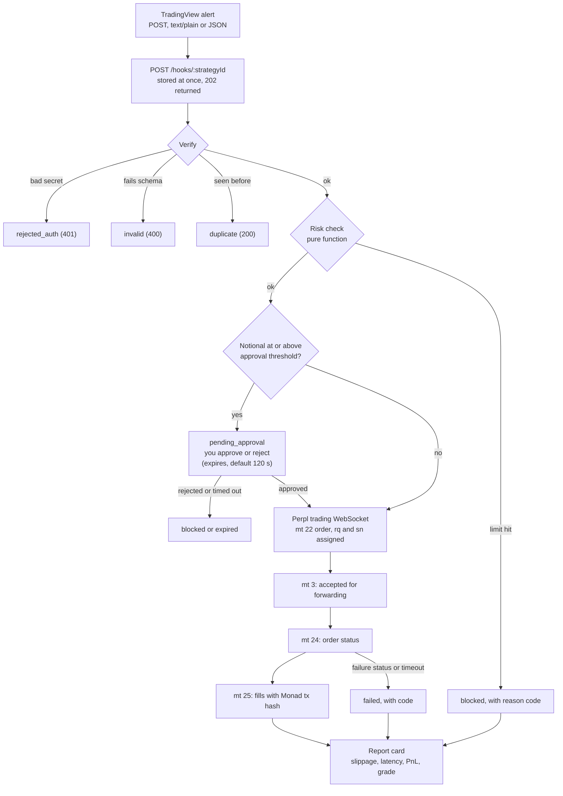

# Hermes

**Hermes turns your TradingView alerts into Perpl orders within a second, inside limits you set, and shows whether your strategy performs live the way it looked on the chart.**

A trader who already uses TradingView alerts points them at a Hermes webhook. Hermes checks that each alert is genuine, not a repeat and inside the trader's risk limits, places the order on Perpl over its trading WebSocket, and tracks it until it fills or fails. A per-strategy report card then compares the alert price with the fill price, the alert-to-fill time, and every alert that did not become a trade, with the reason.

Built for the Monad Metropolis hackathon. Main track: Onchain Finance & Trading. Bounties: Perpl "Best use of Perpl's API", Privy, and Perpl "Best Analytics / Risk Tool".

| | |
|---|---|
| Live dashboard | Report card |
| [](design/screenshots/dashboard-desktop.png) | [](design/screenshots/report-desktop.png) |
| One alert, every stage | Onboarding: Perpl account |
| [](design/screenshots/alert-desktop.png) | [](design/screenshots/onboarding-step2-desktop.png) |

The screenshots are renders of the design prototype in [`design/prototype/`](design/prototype/), which the web app was built to match. Numbers in them are sample data. Real testnet screenshots will replace them after the live run (see [docs/SUBMISSION.md](docs/SUBMISSION.md)).

Docs: [Demo video script](docs/DEMO.md) | [Submission checklist and bounty mapping](docs/SUBMISSION.md) | [Architecture contract](docs/ARCHITECTURE.md) | [How Hermes uses Privy](docs/PRIVY.md) | [Perpl research notes](docs/research/perpl.md) | [Perpl package](packages/perpl/README.md) | [Web app](apps/web/README.md)

## The problem

- Many traders build their strategies and alerts on TradingView. When an alert fires they still have to open Perpl and place the trade by hand. If they are asleep, busy or offline they miss it, or they enter late at a worse price.
- Tools that turn TradingView alerts into trades exist for Hyperliquid and the large centralised exchanges. We found none for Perpl.
- Traders also never see whether the live result matched the chart: how much price they lost between the alert and the fill, how long it took, and which alerts never became trades.

**Who it is for:** a trader who already uses TradingView alerts and wants them executed on Perpl automatically, with hard safety limits, without writing a bot.

Perpl's co-founder maintains [PerplBot](https://github.com/0x70626a/PerplBot), whose README roadmap lists "PineScript compatibility for TradingView strategies" as an open item. Hermes builds the practical form traders already use: alerts become orders. It does not run Pine Script itself.

## How it works



Every step writes a row to the `alert_events` table with a millisecond timestamp (three decimals), so alert-to-fill latency is measured, not estimated.

| Step | What it guarantees |
|---|---|
| Receive `/hooks/:strategyId` | The alert is stored before anything else happens (secret redacted) and the HTTP reply does not wait for Perpl. TradingView cancels a request after 3 s, so execution runs asynchronously. Body limit 16 KiB. |
| Verify: secret | The per-strategy secret is compared in constant time against the AES-256-GCM encrypted copy. Unknown strategy, disabled strategy, missing secret and wrong secret all return the same `401`. |
| Verify: schema | A tolerant zod schema accepts numbers as strings, empty strings as absent, tickers like `BINANCE:BTCUSDT.P`, and `buy`/`sell` strategy alerts. Anything else gets `400` with the failing fields. |
| Verify: dedupe | An alert with an `id` is a duplicate of any earlier alert with the same `id` on that strategy within 24 h. Without an `id`, the key is a hash of the body without the secret. Duplicates return `200` and never reach Perpl. |
| Risk check | A pure function, so it is the same code in production and in tests. First failing rule wins and the alert is `blocked` with a reason code. Closes are reduce-only and are never trapped by limits. |
| Approval | Orders at or above the threshold wait for you (120 s by default, set by `approvalExpirySec`). Rejecting or timing out ends the alert; nothing is sent. Pending approvals survive a server restart. |
| Perpl WebSocket | Market IOC order with a slippage cap, `lb: 0`. The request id `rq` is strictly increasing per account, seeded from the account's `lfr`, and persisted before the frame is sent. Retries follow Perpl's rules: same `rq` before any status, new `rq` only after a failure status or an expired block window. A disconnect never causes a double fill. |
| `mt 3`, `mt 24`, `mt 25` | `mt 3` only means accepted for forwarding. The real outcome comes from `mt 24` (first non-failure status per `rq` wins) and fills from `mt 25`, which carry the Monad transaction hash. |
| Report card | Computed from the stored events and fills, per strategy, for 24 h, 7 d, 30 d or all time. |

## Features, mapped to the judging criteria

### Main track: Onchain Finance & Trading

- **Product quality and completeness.** Sign-in, onboarding, live alert stream with a per-alert lifecycle bar, strategies with copyable webhook URL and secret, risk limits, approval queue, wallet and keys page, report card, "Send test alert" button. 503 automated tests.
- **Technical excellence.** A Perpl client package with its own protocol simulator and fault injection, an idempotent order state machine, encrypted secrets, a pure risk engine, server-sent events for live updates.
- **Monad integration.** Orders are filled by Perpl's on-chain exchange on Monad testnet, and Hermes records the transaction hash of every fill. Account setup runs through the user's Monad wallet. See [Why Monad](#why-monad).
- **Track fit.** Perpl is an on-chain perpetuals exchange. Hermes makes it usable from the tool most traders already use for signals.
- **Innovation and impact.** Alert execution for an exchange that has none, plus a report card that measures the gap between chart and fill.

### Perpl: Best use of Perpl's API ("production-ready trading bot or automation system")

- **Ed25519 API keys, trade-only.** Signing for the REST API and the WebSocket sign-in frame (`mt 29`) in [`packages/perpl/src/signing.ts`](packages/perpl/src/signing.ts), tested byte for byte against third-party test vectors. Keys cannot withdraw by Perpl's design. Private keys are stored AES-256-GCM encrypted.
- **`rq` idempotency state machine.** [`order-tracker.ts`](packages/perpl/src/order-tracker.ts) allocates `rq` as `max(counter, lfr) + 1`, persists it before sending, serialises sends, de-duplicates statuses, retries once on `sr 32`, reconciles through REST when the outcome is ambiguous, and never re-sends an ambiguous order under a new `rq`.
- **Reconnect and heartbeat rules.** Heartbeat (`mt 100`) sequence must rise by exactly 1, otherwise Hermes reconnects. Exponential back-off `1, 2, 4, 8, 16, 32, 60 s`, immediate reconnect on `1001`, re-sign on `3401`, stale-heartbeat watchdog, and a single same-`rq` re-send after a `1011` close.
- **Rate limits.** A token bucket keeps the trading socket under 60 requests per minute (pings count). Market data stays under 10 requests per minute and 16 subscriptions.
- **Production concerns around the API.** Per-user client registry, health endpoint data (heartbeat age, latency, head block), geo-block (`451`) and rate-limit (`429`, `503`) handling, and a risk gate in front of every order.
- **Verifiable offline.** A protocol simulator (real WebSocket and HTTP server) speaks the same frames, so the whole stack runs in CI without network access.

### Privy: "beyond authentication"

- **Embedded wallet at sign-in.** Email login creates a Monad testnet wallet (`@privy-io/react-auth`).
- **A restricted server signer.** The user adds the Hermes server as a signer on their wallet in one prompt. The signer is a P-256 key in a Privy key quorum, and every request it signs is checked by a Privy policy: chain `10143` only, native value must be 0, targets limited to the Perpl Exchange, the AUSD token (only `approve` to the Exchange, up to a cap, default 10,000 AUSD) and the Agora faucet, all of it valid until an expiry time. Privy policies are default-deny.
- **Setup transactions signed under that policy.** `approve`, `createAccount`, `allowOrderForwarding`, deposits and faucet requests can be sent by the server without a prompt per transaction, through `wallets().ethereum().sendTransaction`.
- **A demonstrated denial.** The wallet page has a policy demo that sends a transaction the policy must refuse (0.001 MON to an arbitrary address, or an `approve` to another spender). The local pre-flight check is skipped on purpose so Privy itself refuses, and Hermes records `denied_by_policy`.
- Details: [docs/PRIVY.md](docs/PRIVY.md), code in [`apps/server/src/privy/`](apps/server/src/privy/).

### Perpl: Best Analytics / Risk Tool (report card)

Per strategy: alert price against fill price (slippage in bps, with a histogram), alert-to-fill latency (median and p95, over time), fill rate, realised PnL with slippage and fee cost, every blocked or missed alert grouped by reason, and a 0 to 100 grade with a published formula (fill rate 40, slippage 35, speed 25; alerts your own limits blocked never lower it, and approval wait time is excluded from speed). Code: [`apps/server/src/reports/report-card.ts`](apps/server/src/reports/report-card.ts), screen: [`apps/web/src/pages/report/`](apps/web/src/pages/report/). The Risk limits page and the daily loss stop cover the risk-tool side.

## Why Monad

- Monad's sub-second blocks and fast finality mean an order sent over Perpl's WebSocket can be forwarded, executed and reported within a few hundred milliseconds. That makes alert-to-fill latency a number worth measuring and putting on a report card. On a slower chain it would be dominated by block time.
- Perpl's order book and settlement are on-chain on Monad. Every fill Hermes reports has a transaction hash you can open in the explorer.
- Low fees make small strategy orders and per-alert setup transactions practical on testnet.

We state measured latency only from live runs. The figures in the table below are filled in after the live run.

## Monad proof

Perpl Exchange contract (Monad testnet, chain id 10143): [`0x1964c32f0be608e7d29302aff5e61268e72080cc`](https://testnet.monadexplorer.com/address/0x1964c32f0be608e7d29302aff5e61268e72080cc)

AUSD collateral token: [`0xa9012a055bd4e0edff8ce09f960291c09d5322dc`](https://testnet.monadexplorer.com/address/0xa9012a055bd4e0edff8ce09f960291c09d5322dc) (read at runtime from `GET /v1/pub/context`)

### Testnet transactions

Explorer link format: `https://testnet.monadexplorer.com/tx/<hash>`

| # | What | Signed by | Transaction |
|---|---|---|---|
| 1 | AUSD `approve(Exchange, amount)` | user's Privy wallet, via Hermes signer under the policy | TODO: fill after live run |
| 2 | Exchange `createAccount(amount)` | user's Privy wallet, via Hermes signer under the policy | TODO: fill after live run |
| 3 | Exchange `allowOrderForwarding(true)` | user's Privy wallet, via Hermes signer under the policy | TODO: fill after live run |
| 4 | Order fill from a TradingView alert (`mt 25` fill, `at.txid`) | Perpl, on the user's account | TODO: fill after live run |
| 5 | Privy policy-denied attempt | Hermes server signer | No hash, the transaction is never broadcast. Privy error recorded as `denied_by_policy`: TODO: paste the error text after live run |

## Quick start (simulator mode, no external accounts)

Everything runs locally against the built-in Perpl simulator. No Privy app, Perpl account, TradingView plan or testnet funds are needed.

Prerequisites: Node 22 and pnpm 10.

```bash
pnpm install
cp .env.example apps/server/.env      # optional in simulator mode, every value has a default
pnpm --filter @hermes/server seed:demo
pnpm dev                              # server on :8787 and web on :5173
```

Open http://localhost:5173 and click "Sign in" (without a Privy app id the web app runs in dev mode and the server treats every request as one demo user). `seed:demo` creates two strategies, about 200 historical alerts over 14 days, and a simulated Perpl account with 10,000 AUSD. It prints each strategy's webhook URL and secret.

In a second terminal, stream TradingView-style alerts at the local server:

```bash
pnpm --filter @hermes/server demo:alerts                    # until Ctrl-C
pnpm --filter @hermes/server demo:alerts -- --duration 60
pnpm --filter @hermes/server demo:alerts -- --count 20 --speed 2
```

The first alerts are scripted so a short run shows every outcome: opens, a duplicate re-delivery, an over-limit size, a disallowed market, then closes. You can also use "Send test alert" on any strategy. It posts exactly the message TradingView would send, through the same `/hooks/:strategyId` endpoint.

Other scripts:

| Command | What it does |
|---|---|
| `pnpm dev` | Server and web in watch mode |
| `pnpm build` | Build all workspaces |
| `pnpm test` | All tests |
| `pnpm typecheck` | Type-check all workspaces |
| `pnpm lint` | ESLint on `apps/server` and `packages` |
| `pnpm --filter @hermes/server seed:demo` | Seed the demo user |
| `pnpm --filter @hermes/server demo:alerts` | Alert stream for demos and screenshots |
| `pnpm --filter @hermes/server privy:bootstrap` | One-time Privy key quorum and policy |
| `pnpm --filter @hermes/perpl sim -- --port 8787` | Run the Perpl simulator on its own |
| `pnpm --filter @hermes/web preview` | Serve the production web build on :4173 |

## Live testnet setup

Do this once to run the real thing. Budget about 30 minutes. No real money is involved on any protocol.

### 1. Privy app

1. Create an app at https://dashboard.privy.io. Enable **email** login. Add `http://localhost:5173` (and your deployed web origin, if any) to the allowed origins.
2. Copy the App ID and App Secret. In `apps/server/.env` set `PRIVY_APP_ID` and `PRIVY_APP_SECRET`. In `apps/web/.env` set `VITE_PRIVY_APP_ID` (the web app switches from dev mode to Privy when this is set).
3. Run `pnpm --filter @hermes/server privy:bootstrap`. It creates the "Hermes server" key quorum and the Hermes wallet policy in Privy and prints `PRIVY_AUTHORIZATION_PRIVATE_KEY`, `PRIVY_KEY_QUORUM_ID`, `PRIVY_POLICY_ID`, `PRIVY_POLICY_EXPIRES_AT` and `PRIVY_APPROVE_CAP`. Paste them into `apps/server/.env`. Nothing is written to disk. The private key is a secret.

### 2. Perpl testnet account

1. Sign in to Hermes. The embedded wallet address is on the onboarding page and on `/wallet`. Onboarding step 1 asks you once to add the Hermes server as a signer on your wallet (restricted by the Hermes policy).
2. Get testnet MON for gas from https://faucet.monad.xyz.
3. Get test AUSD with the "Get AUSD" row in onboarding step 2, which asks the Agora testnet faucet. Perpl needs at least **100 AUSD** to open a testnet account.
4. Onboarding step 2 then sends `approve`, `createAccount` (with the deposit) and `allowOrderForwarding` from your wallet, signed by the Hermes server under the policy. Allowing order forwarding is required: without it every order is refused.
5. Create a **trade-only** API key at https://testnet.perpl.xyz/apikeys (one wallet signature) and paste it into onboarding step 3. Perpl API keys cannot withdraw or transfer funds. Hermes validates the key by signing in before saving it.

### 3. Switch to live mode

In `apps/server/.env`:

```bash
PERPL_MODE=live
PUBLIC_BASE_URL=https://<your-tunnel-host>
```

`PERPL_API_BASE`, `PERPL_WS_BASE` and the contract addresses default to the testnet values. Set `HERMES_MASTER_KEY` to 64 hex characters (`node -e "console.log(require('crypto').randomBytes(32).toString('hex'))"`) so stored secrets survive restarts.

**Geo note.** Perpl has answered trading endpoints with HTTP 451 from US datacenter IPs on mainnet, and its `geo_block` list in `GET /v1/pub/context` has included BY, CU, GB, IR, KP, RU, SY, UA and US. Host the backend outside the US and GB (an EU region works), and never call Perpl from the browser: Perpl refuses other origins, and Hermes proxies everything through its backend. Hermes reports a 451 as `perpl_geo_blocked`.

### 4. Public HTTPS URL

TradingView only posts to ports 80 and 443, so the server needs a public HTTPS address. A free Cloudflare Tunnel is enough:

```bash
cloudflared tunnel --url http://localhost:8787
```

Set `PUBLIC_BASE_URL` to the printed `https://...trycloudflare.com` URL and restart the server, so the webhook URLs shown in the UI are the public ones.

### 5. TradingView

1. TradingView needs a **paid plan** (the free plan cannot send webhooks; paid plans have a 30-day trial) and **two-factor authentication** on the account.
2. In Hermes open **Strategies**, create a strategy, and copy its webhook URL (`<PUBLIC_BASE_URL>/hooks/<strategyId>`) and secret. The strategy page also shows the two message templates below with your secret filled in.
3. In TradingView create an alert on your strategy or indicator. On the **Notifications** tab enable **Webhook URL** and paste the Hermes URL. In **Message**, paste a template.
4. TradingView does not list Perpl, so run the chart on another exchange's market for the same asset (for example `BINANCE:BTCUSDT.P`). Hermes maps `BTCUSDT.P` to the Perpl BTC market. Very short timeframes will show more difference between the alert price and the Perpl fill.
5. Fire a test with **Send test alert** on the strategy page before relying on the alert.

## Alert message format

`POST /hooks/:strategyId` with the message as the body. TradingView sends `application/json` when the message is valid JSON and `text/plain` otherwise. Hermes accepts both and parses the body itself. TradingView cannot set headers, so the secret goes in the body.

Templates (as generated by the app; `YOUR_SECRET` is replaced with the strategy secret):

Strategy alert, for `strategy.entry` and `strategy.exit` orders:

```json
{
  "secret": "YOUR_SECRET",
  "id": "{{strategy.order.id}}-{{timenow}}",
  "action": "{{strategy.order.action}}",
  "market": "{{ticker}}",
  "size": "{{strategy.order.contracts}}",
  "market_position": "{{strategy.market_position}}",
  "price": "{{close}}",
  "time": "{{timenow}}"
}
```

Indicator alert (`action` is chosen when you create the alert, here an open long of 100 USD):

```json
{
  "secret": "YOUR_SECRET",
  "action": "buy",
  "market": "{{ticker}}",
  "size_usd": "100",
  "price": "{{close}}",
  "time": "{{timenow}}"
}
```

For a close, use `"action": "close"` (or `close_long`, `close_short`) and omit the size.

| Field | Required | Meaning |
|---|---|---|
| `secret` | yes | The strategy secret. Compared in constant time, never stored. |
| `action` | yes | `buy`, `sell`, `long`, `short`, `close_long`, `close_short`, `close`, `flat`. Case-insensitive. |
| `market` | if the strategy has no default | Any ticker form (`BTC`, `BTCUSDT.P`, `BINANCE:BTCUSDT.P`, `BTC-PERP`) is reduced to a Perpl base symbol. Unknown symbols are blocked as `market_not_allowed`. |
| `size_usd` | opens, unless `size` or a strategy default exists | Notional in USD. |
| `size` | alternative to `size_usd` | Base units or contracts. Send only one of the two. |
| `leverage` | no | Falls back to the strategy default. Checked against your max leverage. |
| `price` | recommended | The chart price at the alert. It is the reference for slippage on the report card. |
| `id` | recommended for strategies | Idempotency key. Same `id` on the same strategy within 24 h is a duplicate. |
| `max_slippage_bps` | no | Cap for the market order. Default is your `defaultSlippageBps` (50). |
| `time` | no | Alert time (ISO string or epoch). Used for the stale-alert check. |
| `market_position` | strategy alerts | `{{strategy.market_position}}`, the position after the order. Tells Hermes whether a `buy` or `sell` opens or closes. |
| `order_type`, `limit_price` | no | `market` is the only type executed. A `limit` alert is accepted, then fails with `limit_orders_unsupported`. |
| `comment` | no | Free text, up to 500 characters. |

How `buy` and `sell` are read for strategy alerts: with no `market_position`, `buy` opens a long and `sell` opens a short. With it, `buy` plus `flat` or `short` closes a short, and `sell` plus `flat` or `long` closes a long. A reversal in one order (long to short) arrives as `sell` plus `short` and is treated as an open short, so configure the strategy to send separate close and open alerts.

Responses: `202 {"alertId"}` accepted, `200 {"alertId","duplicate":true}`, `400 invalid_payload` with the failing fields, `401 unauthorized`.

## Risk limits

Set on the **Risk limits** page (`GET`/`PUT /api/limits`). They apply to every strategy of the user. Defaults:

| Limit | Default | Effect |
|---|---|---|
| `allowedMarkets` | BTC, ETH, SOL, MON, ZEC | Opens outside the list are blocked. |
| `maxPositionUsd` | 5000 | Existing same-side position plus the new order may not exceed it. |
| `maxLeverage` | 10 | Orders asking for more are blocked. |
| `dailyLossStopUsd` | 500 | New positions are blocked once today's PnL (since 00:00 UTC) is at or below minus this amount. 0 disables. |
| `approvalExpirySec` | 120 | How long an order above the threshold waits for your decision before it expires. |
| `approvalThresholdUsd` | 2500 | Orders with notional at or above this wait for your approval. 0 disables approvals. |
| `maxAlertAgeSec` | 60 | Alerts older than this (by their own `time`, else by receipt) are blocked. |
| `maxOrdersPerMinute` | 30 | Orders in the last 60 s. |
| `defaultSlippageBps` | 50 | Slippage cap when the alert has none. Clamped to the market's maximum. |
| `paused` | false | Blocks new positions. Closes still go through. |

Block reasons, in the order they are checked (first failure wins):

| Reason | Label in the UI | Applies to |
|---|---|---|
| `strategy_disabled` | Strategy is disabled | all |
| `stale_alert` | Alert arrived too late | all |
| `rate_limited` | Too many orders per minute | all |
| `perpl_not_connected` | Perpl is not connected | all |
| `no_position_to_close` | No open position to close | closes only (a close then stops here; it ignores the checks below) |
| `trading_paused` | Trading is paused | opens |
| `market_not_allowed` | Market not in your allowed list | opens |
| `daily_loss_stop_hit` | Daily loss stop reached | opens |
| `invalid_size` | Order size could not be determined | opens |
| `leverage_above_max` | Leverage above your max | opens |
| `size_above_max` | Position would exceed your max size | opens |
| `approval_rejected` | You rejected the approval | after approval |
| `approval_expired` | Approval timed out | after approval |

## Architecture

```
hermes/
  apps/
    server/            Fastify 5 API, webhook receiver, pipeline, SQLite
      src/ingest/      POST /hooks/:strategyId: auth, schema, dedupe
      src/risk/        pure evaluate(intent, limits, state)
      src/pipeline/    risk -> approval -> executor, alert_events transitions
      src/execution/   PerplExecutor: order intent -> Perpl client
      src/perpl/       per-user client registry, simulator wiring
      src/privy/       policy, server signer, wallet actions, policy demo
      src/reports/     report card computation
      src/api/         REST for the web app, SSE stream
      src/db/          schema, migrations, repositories
      src/scripts/     seed-demo, demo-alerts
    web/               React 18, Vite, Tailwind v4, Privy React SDK
  packages/
    perpl/             Ed25519 signing, REST, trading and market-data sockets,
                       order tracker, chain helpers, protocol simulator
    shared/            zod schemas and types shared by server and web
  design/              design spec, HTML prototype, screenshots
  docs/                architecture, Privy notes, research, demo script, submission
```

**Stack.** TypeScript, Node 22, pnpm workspaces. Server: Fastify, `better-sqlite3` (WAL), zod, `ws`, `viem`, `@privy-io/node`. Web: React, Vite, Tailwind CSS v4, `@privy-io/react-auth`, TanStack Query, React Router, `viem`. Tests: Vitest.

**Data model.** SQLite tables: `users`, `perpl_connections` (encrypted API key, `last_rq`), `strategies` (encrypted secret, defaults), `risk_limits`, `alerts`, `alert_events` (one row per lifecycle transition, the source of truth for timings), `orders` (`rq`, `sn`, `lb`, status, tx hash), `fills`, `positions`, `approvals`, `daily_pnl`, `privy_wallets`, `wallet_actions` (including `denied_by_policy`).

**Live updates.** The web app opens one Server-Sent Events stream (`GET /api/stream`) and patches its caches from it, so alert rows move through their stages without polling.

**Security.**

- No secrets in the repository. `.env.example` has names only, and `.env` files are git-ignored.
- Webhook secrets and Perpl API private keys are encrypted at rest with AES-256-GCM, keyed by `HERMES_MASTER_KEY` (required in production).
- Secret comparison is constant time and every authentication failure returns the same response.
- Perpl API keys are trade-only and cannot withdraw. The browser never holds them and never talks to Perpl.
- The Hermes server key can only act inside the Privy policy: one chain, zero native value, three contracts, an approve cap and an expiry. The user can remove the signer at any time.
- A leaked webhook URL alone cannot trade: it needs the secret. A leaked secret can only place orders that pass your risk limits.

## Testing

```bash
pnpm test         # all workspaces
pnpm typecheck
pnpm lint
```

Last measured: 503 tests passing. Typecheck and lint were clean in all four workspaces at that run.

| Package | Test files | Tests | What is covered |
|---|---|---|---|
| `packages/perpl` | 9 | 211 | Ed25519 signing against third-party vectors, protocol parsing, scaling, every branch of the `rq` retry state machine (fake timers and fake socket), the simulator's protocol rules, and the full client against the simulator with injected faults (dropped status, disconnect before status, rejection, heartbeat gap, partial fill) |
| `apps/server` | 13 | 187 | Webhook auth, schema and dedupe, the risk engine, the pipeline and approval flow, the Perpl executor, end to end alert-to-fill against the simulator, report card maths, Privy policy mirror and wallet API, crypto, REST API, stored risk checks and Perpl frames, markets endpoint |
| `apps/web` | 8 | 76 | Formatting, alert lifecycle view model, SSE stream handling, UI primitives, wallet and key error flows, a guard against CSS classes colliding with Tailwind utilities |
| `packages/shared` | 1 | 29 | Alert parsing, ticker normalisation, intent resolution |

## Honest limitations

- **The build sandbox could not reach `testnet.perpl.xyz` or the Monad RPC.** The Perpl code was written from the published API docs and cross-checked against a working third-party integration. It is tested against the simulator, which speaks the same protocol (same frames, statuses, heartbeats, rate limits, close codes), but it has not been run against live Perpl in this repository's history before the live run recorded in [docs/SUBMISSION.md](docs/SUBMISSION.md). The simulator has synthetic prices and fills at mark plus or minus at most 8 bps, so slippage and latency figures from it say nothing about live behaviour. It does not model funding, liquidation, trigger orders or builder fees.
- **Privy policy syntax is not verified against the live API.** The docs site was unreachable while building. Rule and condition shapes were checked against the `@privy-io/node` 0.35.0 type definitions. Still to confirm on the first live run: the `ethereum_calldata` field names (`approve.spender`, `approve.amount`), address case handling in conditions, and the exact error Privy returns on a policy denial (Hermes treats a 4xx whose message mentions a policy as a denial).
- **Perpl details still unverified:** whether server-side API key enrolment works without a whitelisted Origin (Hermes uses the paste-in key as the supported path); whether testnet answers 451 to US IPs; the live collateral token and minimum (read at runtime); how many AUSD the Agora faucet pays out and whether it is funded; whether the `lb: 0` order window equals `order_ttl_blocks` (Hermes assumes a block window of `ttl + 5` for timeouts); whether heartbeats arrive on the trading socket every block (otherwise Hermes falls back to the market-data heartbeat and REST); what Perpl re-emits when an executed `rq` is re-sent. Full list: [packages/perpl/README.md](packages/perpl/README.md#known-uncertainties-from-perplmd-plus-ours) and [docs/research/perpl.md](docs/research/perpl.md).
- **Scope.** Market orders only (IOC with a slippage cap). No native stop-loss or take-profit orders, no limit orders, no Pine Script execution, no mainnet, one net position per market. Strategy reversals in a single TradingView order are read as an open, not close-then-open.
- **Latency is not yet measured on live Perpl.** Treat any figure in the screenshots as sample data.
- **Missed deliveries are invisible.** TradingView documents no retries. If it fails to deliver an alert, Hermes never sees it, and the report card cannot count what it did not receive.

## AI tools disclosure

Built with Claude Code (Anthropic). An orchestrating agent coordinated sub-agents for research, UI design, and implementation; all code was reviewed and tested in this repository.

## Licence

MIT. See [LICENSE](LICENSE).
